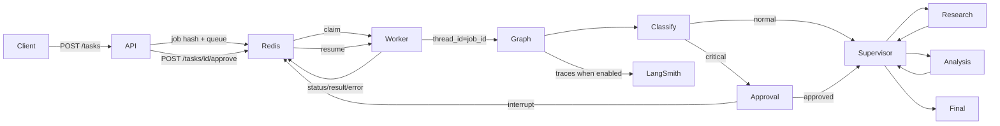

# Async multi-agent job API

This FastAPI prototype exposes the [module 6 multi-agent incident orchestrator](https://github.com/gullojoseleandro/multi-agent-research-orchestrator) through a Redis-backed queue. A separate worker executes each LangGraph run. Critical requests pause at a human-approval node; the API never waits for an LLM response before returning a job ID.

## Start locally

1. Install Docker Desktop and make sure it is running.
2. Copy `.env.example` to `.env`. Replace `ADMIN_TOKEN` with a long random secret. For a free, credential-free functional demo, keep `MODEL_MODE=offline` and `LANGSMITH_TRACING=false`.
3. Run `docker compose up --build -d` from this repository.
4. Check `http://127.0.0.1:8000/health` and `http://127.0.0.1:8000/docs`.

Redis 8 provides the RedisJSON and RediSearch capabilities required by `AsyncRedisSaver`. The Compose stack contains Redis, one API process, and one worker process; Redis persists both jobs and LangGraph checkpoints in a named volume. The API is bound to localhost and is **not an Internet-facing production deployment**: add authentication for all task endpoints, TLS, worker scaling, and operational recovery before exposing it publicly.

If Docker's default address pools are exhausted on your machine, use a local untracked `docker-compose.override.yml` with a free subnet; do not remove unrelated Docker networks to make space.

### Use an NVIDIA-hosted model

NVIDIA Developer Program members can use hosted NIM endpoints for **prototyping**, subject to NVIDIA's access and rate limits; this is not an unlimited production tier. Obtain a developer API key from the [NVIDIA API Catalog](https://docs.api.nvidia.com/nim/docs/api-quickstart), then set these values in the ignored `.env`:

```env
MODEL_MODE=nvidia
NVIDIA_API_KEY=<your NVIDIA developer key>
NVIDIA_MODEL_NAME=meta/llama-3.1-8b-instruct
```

Run `docker compose up -d --build` to recreate the worker with the new configuration. This mode uses NVIDIA's [OpenAI-compatible chat endpoint](https://docs.api.nvidia.com/nim/reference/meta-llama-3_1-8b-infer) through the existing async LangChain client, with function calling for the supervisor's validated route decision. `MODEL_MODE=openai` and `MODEL_MODE=offline` remain available. Never reuse an OpenAI key as `NVIDIA_API_KEY`; do not commit `.env`.

## Use the API

Submit a normal request (PowerShell):

```powershell
$task = Invoke-RestMethod -Method Post -Uri http://127.0.0.1:8000/tasks -ContentType 'application/json' -Body '{"query":"Investigate INC-104 and calculate the p95 latency increase"}'
$task.job_id
Invoke-RestMethod -Uri "http://127.0.0.1:8000/tasks/$($task.job_id)"
```

`POST /tasks` returns HTTP 202 with `job_id` and `PENDING`. `GET /tasks/{job_id}` shows `PENDING`, `RUNNING`, `WAITING_APPROVAL`, `DONE`, or `FAILED`; failures include a bounded error string rather than leaving the job pending forever.

A request containing a critical action or high-cost term (for example, `Deploy fix for INC-104`) pauses **before** specialist work. Once the status is `WAITING_APPROVAL`, submit `{"approved": true}` or `{"approved": false}` to `POST /tasks/{job_id}/approve` with the `X-Admin-Token` header. Only one decision can be accepted for a pause. Rejection ends the run without specialist calls. The demo has no side-effecting tools; approval is an explicit exercise of the checkpoint/resume path.

```powershell
$headers = @{ 'X-Admin-Token' = '<your ADMIN_TOKEN from .env>' }
Invoke-RestMethod -Method Post -Uri "http://127.0.0.1:8000/tasks/$($task.job_id)/approve" -Headers $headers -ContentType 'application/json' -Body '{"approved":true}'
```

## Observability and five-request evidence

To record **real** model traces, use `MODEL_MODE=nvidia` with `NVIDIA_API_KEY` (or `MODEL_MODE=openai` with `OPENAI_API_KEY`), set `LANGSMITH_API_KEY` and `LANGSMITH_TRACING=true` in the ignored `.env`, then restart the API and worker with `docker compose up -d --build`. The worker runs the LangGraph nodes and the live supervisor under LangSmith tracing; `app/supervisor.py` also explicitly instruments the decision call. Queries and retrieved source text are sent to LangSmith in this mode, so use only non-sensitive sample data. [LangSmith documents automatic token-based cost tracking](https://docs.langchain.com/langsmith/cost-tracking). For a NVIDIA model not already in LangSmith's pricing table, configure a [custom model price entry](https://docs.langchain.com/langsmith/cost-tracking) matching the traced model **before** the test run; use the actual price for your account (zero only when your NVIDIA usage is genuinely free). LangSmith does not backfill pricing changes into earlier traces. Do not label a free NVIDIA call as paid OpenAI usage or invent a nonzero charge.

With the stack running, create a Python 3.12 environment, install `requirements-dev.txt`, and run:

```powershell
python load_test.py --output load-run.json
```

The script submits **five requests concurrently**, polls each to a terminal status, and prints the client-observed nearest-rank p95 for five completed runs (the slowest of five). It writes JSON only if `--output` is supplied. For the assignment, capture genuine LangSmith trace and per-execution cost screenshots into `screenshots/`. Filter to the five-run time window and show model tokens, the run tree, and per-trace cost. The LangSmith [dashboard docs currently list p50 and p99, not p95, for latency charts](https://docs.langchain.com/langsmith/dashboards); pair a dashboard trace-duration view with the clearly labeled five-run p95 calculation, or use a monitoring platform that can display p95 directly. **Offline runs have no real model cost and do not satisfy the cost-evidence requirement.**

An observed five-request offline run is saved in [`evidence/offline-load.json`](evidence/offline-load.json). All five jobs completed; its client-observed p95 was 0.939 seconds. This proves API queuing and worker completion, **not** dashboard cost or live LLM performance.

The code does not contain screenshots manufactured from tests. `screenshots/README.md` identifies exactly what still needs to be captured after a live run.

## Tests

```powershell
python -m unittest discover -s tests -v
```

The offline suite uses a fake Redis client for API/worker tests and an in-memory LangGraph checkpointer for HITL. To also verify **real Redis checkpoint persistence across graph reconstruction**, run `TEST_REDIS_URL=redis://localhost:6379/0 python -m unittest discover -s tests -p test_redis_integration.py -v` in a shell with a reachable Redis 8 instance. Redis 8's Search and JSON modules must be available. The worker tests cover `FAILED` transition and approval pause; API tests cover five concurrent enqueues, polling, authentication, and single-use approval.

## Architecture



The API only enqueues; the separate worker owns `graph.ainvoke()`. Redis job hashes and a Redis queue outlive API restarts. `AsyncRedisSaver` stores checkpoints so `Command(resume=...)` can continue the same `thread_id` after an approval, including after worker reconstruction. The worker records `FAILED` on graph errors and recovers claimed jobs on its next start. This exercise intentionally runs **one worker**; multi-worker ownership/leases are future work.
