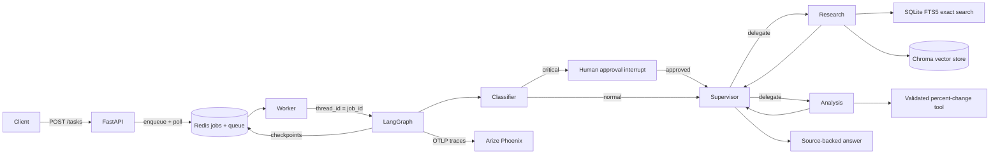

# Intelligence System

A local, asynchronous incident-analysis system. FastAPI queues requests in Redis; a LangGraph supervisor delegates research and analysis; research combines SQLite FTS5 exact lookup with persisted Chroma semantic search. The worker uses a local Ollama model, stores checkpoints in Redis, and exports traces to local Arize Phoenix. No paid model API key is required by default.

This is a **local evaluation prototype**, not a public Internet service. API and Phoenix bind to localhost; task endpoints lack user authentication and Phoenix authentication is disabled for the local demo. Do not expose either service publicly or load sensitive documents.

## One-command start (Windows)

Install and start Docker Desktop, then run from PowerShell:

```powershell
powershell -ExecutionPolicy Bypass -File .\start-project.ps1
```

The script creates an ignored `.env` with a random admin token if absent, then runs Docker Compose. Compose starts Redis, Ollama, Phoenix, a model-pull job, an idempotent Chroma ingestion job, the API, and a worker. The first start downloads `gemma3:1b` and `embeddinggemma:300m-qat-q4_0` and may take several minutes. Subsequent starts reuse named volumes. CPU-only inference can be slow.

Open [API docs](http://127.0.0.1:8000/docs) and [Phoenix](http://127.0.0.1:6006). Check `docker compose ps`; inspect errors with `docker compose logs --tail=100`. Stop with `docker compose down` (named volumes remain). On macOS/Linux, copy `.env.example` to `.env`, replace `ADMIN_TOKEN` with a random secret, then run `docker compose up -d --build`.

## Exercise the system

```powershell
$task = Invoke-RestMethod -Method Post -Uri http://127.0.0.1:8000/tasks -ContentType 'application/json' -Body '{"query":"Investigate INC-104 and calculate the p95 latency increase"}'
Invoke-RestMethod -Uri "http://127.0.0.1:8000/tasks/$($task.job_id)"
```

`POST /tasks` returns `202` and a job ID immediately; poll `GET /tasks/{job_id}` until `DONE`, `FAILED`, or `WAITING_APPROVAL`. Try `INC-999` as an absent-source trap: a calculation must not be invented. A critical action such as `Deploy fix for INC-104` pauses before specialist work. To approve it, send `POST /tasks/{job_id}/approve` with `{"approved":true}` and the `X-Admin-Token` header using the generated value in `.env`. The demo has no side-effecting tools; approval demonstrates checkpoint/resume only.

To run five concurrent API requests, use Python 3.12:

```powershell
python -m venv .venv
.\.venv\Scripts\python.exe -m pip install -r requirements-dev.txt
.\.venv\Scripts\python.exe load_test.py --timeout 1800 --output evidence/local-five-run.json
```

The JSON contains job IDs, queries, terminal statuses, answers, and client-observed latencies. A run is valid evidence only if all five jobs reach `DONE`; inspect the corresponding job IDs in Phoenix at `http://127.0.0.1:6006`. Traces contain prompts and report excerpts.

An observed local Ollama run is recorded in [`evidence/live-five-run.json`](evidence/live-five-run.json): all five jobs reached `DONE`, four answers cited their incident report, and the unknown `INC-999` returned no invented calculation. The client-observed nearest-rank p95 was 228.798 seconds on a CPU-only host. [`evidence/phoenix-five-traces.json`](evidence/phoenix-five-traces.json) records a Phoenix `worker.graph` root span and a `ChatOllama` model span for each of those exact five job IDs, plus token totals. These are observed local measurements, not a latency or cost guarantee.

## Architecture



The supervisor uses an LLM for route decisions, with a five-decision guard and graph recursion limit of 16. An explicit incident ID filters semantic hits to that incident, preventing unrelated measurements from contaminating calculations. The final node answers only when a cited report contains complete, consistent measurements. `data/*.md` is the sample corpus; ingestion uses 500-token chunks with 50-token overlap, stable IDs, embedding-model metadata checks, and persistent Chroma storage. Indexing and querying use the same Ollama embedding model.

## Configuration and verification

`.env.example` lists all variables. The default stack needs no OpenAI, NVIDIA, LangSmith, or Pinecone key. Other supervisor backends remain available in code; the local Compose worker explicitly uses `ollama`. Never commit `.env`, keys, `vectorstore/`, or local trace data.

```powershell
.\.venv\Scripts\python.exe -m unittest discover -s tests -v
```

The suite includes fake-Redis API/worker tests, Chroma ingestion/retrieval tests with fake embeddings, and an optional real Redis checkpointer integration test (`TEST_REDIS_URL` must point to Redis 8). Docker validation and Phoenix evidence are separate from unit tests; a passing unit suite alone does not prove live inference or traces.

## Boundaries

- Redis persists jobs and checkpoints across API/worker restarts; the sample runs one worker and does not implement multi-worker leases.
- Chroma and SQLite FTS5 are local, rebuildable indexes, not cloud-scale infrastructure.
- Phoenix receives local OTLP traces; no real monetary cost is claimed for Ollama.
- API task endpoints require authentication and TLS before public deployment.
